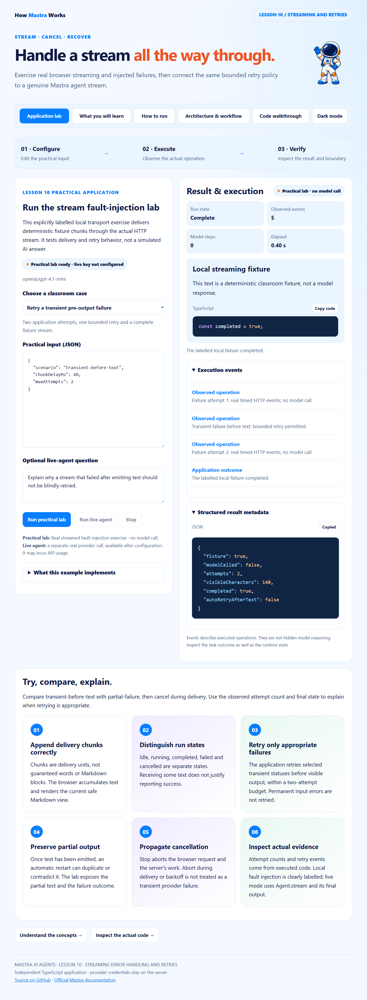

# Mastra · Lesson 10 · Streaming Error Handling and Retries

Exercise real browser streaming and injected failures, then connect the same bounded retry policy to a genuine Mastra agent stream.



## Start

Use Node.js 24+. This is an independent repository.

```powershell
git clone https://github.com/luiscoco/Udemy-Mastra-lesson10-app.git
cd Udemy-Mastra-lesson10-app
npm ci
npm start
```

Open http://127.0.0.1:3210. **Run practical lab** executes: Real streamed fault-injection exercise · no model call. Starting the host makes no model call.

## Five student pages

Application lab · What you will learn · How to run · Architecture & workflow · Code walkthrough. They preserve the approved lesson 1 astronaut, typography, colors, light/dark theme, responsive layout, safe Markdown rendering, syntax colors and copy-code controls.

## Implemented exercise

This explicitly labelled local transport exercise delivers deterministic fixture chunks through the actual HTTP stream. It tests delivery and retry behavior, not a simulated AI answer.

- **Retry a transient pre-output failure:** Two application attempts, one bounded retry and a complete fixture stream.
- **Fail after partial output:** Partial text remains visible and is not automatically replayed.
- **Test Stop while streaming:** Use Stop during delivery; cancellation must not trigger a retry.

The local lab uses controlled fixture text and injected errors to exercise real HTTP delivery. Live mode invokes Mastra Agent.stream. The application does not claim invented provider performance or hidden reasoning.

## Optional actual model run

Preserve any existing local configuration. No credential has been copied from another app.

```powershell
if (!(Test-Path .env)) { Copy-Item .env.example .env }
notepad .env
```

Enter your own provider key, choose a model your account can access, and restart. Keys stay on the server and are ignored by Git. Shell values take precedence over the optional file. Live generation may incur provider usage; the normal practical operation does not.

```dotenv
# Set your own provider credential locally. No credential is copied from another app.
OPENAI_API_KEY=your_api_key
MASTRA_MODEL=openai/gpt-4.1-mini
PORT=3210
```

## Build and test

```powershell
npm run sample
npm run sample:live
npm run build
npm test
npm run test:browser
```

The normal sample executes the real key-free operation. The live sample requires provider configuration. Offline SDK integration tests use Mastra's explicit model-test adapter and do not make paid model calls. Browser tests execute the real local lab, navigate all five pages, check responsive behavior and safe code rendering, and capture this app's own preview. Set BROWSER_EXECUTABLE for a nonstandard Chrome/Chromium path.

Source-linked excerpts and the browser script are generated from the actual implementation. Rebuild after editing source. Generated public files and dependency lockfiles are committed for reproducibility.

## Student exercise

Compare transient-before-text with partial-failure, then cancel during delivery. Use the observed attempt count and final state to explain when retrying is appropriate.

## Key source files

- [src/lab.ts](src/lab.ts)
- [src/mastra/retries.ts](src/mastra/retries.ts)
- [src/mastra/agents.ts](src/mastra/agents.ts)
- [src/mastra/index.ts](src/mastra/index.ts)
- [Request host](src/server.ts)
- [Execution envelope](src/runner.ts)
- [Student page generator](scripts/build-pages.ts)

## References

- [Approved lesson 1 baseline](https://github.com/luiscoco/Udemy-Mastra-lesson01-app)
- [Mastra streaming guide](https://mastra.ai/docs/guides/streaming)
- [Agent generation and limits](https://mastra.ai/reference/agents/generate)

The astronaut, base styles and Prism integration follow the user's approved course assets. Prism's license remains in public/prism-LICENSE.txt. This application's lesson-specific operations, contracts, examples and explanations are tailored to Lesson 10.
